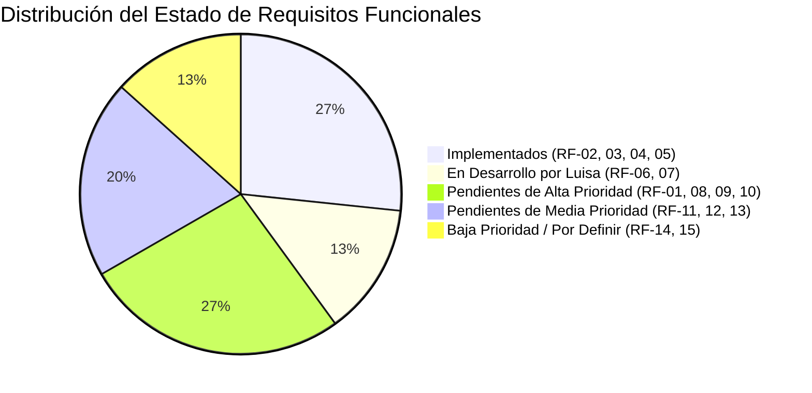
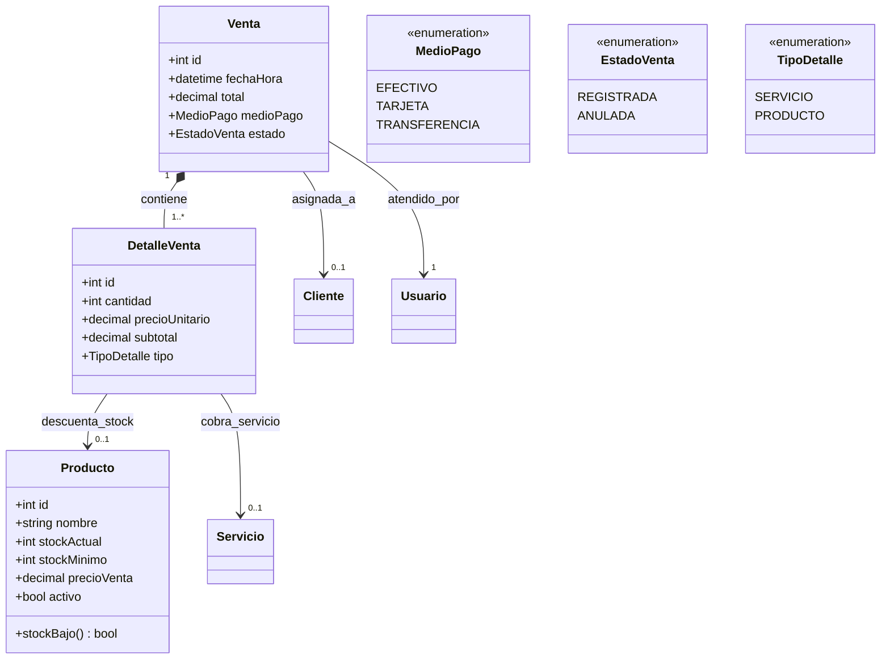

# StudioGest — Diagnóstico de Requisitos Faltantes y Plan de Trabajo

**Proyecto:** StudioGest · Sistema Web de Gestión para Barberías y Peluquerías  
**Asignatura:** Desarrollo de Software y Aplicaciones Web II (Cartagena de Indias, 2026)  
**Equipo:** Luis Antonio Escudero Suárez · Luisa Fernanda Gómez Andrade · Brayan Camilo Merchan Maldonado  
**Rama activa de trabajo:** `brayan`  
**Fecha de corte:** Octubre de 2026  

---

## 1. Resumen Ejecutivo del Estado del Software

El proyecto cuenta con la base arquitectónica de Django 5.2, autenticación básica, la plantilla base responsive con Tailwind CSS, el CRUD de clientes (`apps/customers`) y el motor de agenda semanal con validación estricta de solapamientos de turnos (`apps/appointments`).

Dado que **Luisa** se encuentra desarrollando el catálogo y vistas de **Servicios y Profesionales** (RF-06 y RF-07), el núcleo pendiente más crítico corresponde a **Inventario (RF-08, RF-09)**, **Ventas y Caja (RF-10, RF-11)** e **Historial/Privacidad del Cliente (RF-12, RNF-05)**.

---

## 2. Matriz de Requisitos Funcionales (RF-01 a RF-15)

| ID | Requisito | Prioridad | Estado Actual | Brecha / Lo que falta implementar |
| :--- | :--- | :---: | :---: | :--- |
| **RF-01** | Inicio de sesión y control de acceso por rol | **Alta** | 🟡 Parcial | El modelo `User` solo define `ADMIN` y `TRABAJADOR`. La documentación (Tabla IV y Fig. 17) exige el rol **`CAJA_RECEPCION`**. Falta restringir acceso a reportes y configuraciones para barberos y cajeros. |
| **RF-02** | Gestión y búsqueda de clientes | **Alta** | 🟢 Implementado | CRUD y buscador por nombre/teléfono funcionales en `apps/customers`. Falta el campo de consentimiento de datos (Ley 1581). |
| **RF-03** | Crear, modificar y cancelar citas | **Alta** | 🟢 Implementado | Implementado en `apps/appointments`. |
| **RF-04** | Validación de citas solapadas por barbero | **Alta** | 🟢 Implementado | Validado en `Appointment.clean()`. Rechaza solapamientos al 100%. |
| **RF-05** | Vista de agenda por día y por profesional | **Media** | 🟢 Implementado | Vista semanal y por profesional disponible en `appointments/calendar`. |
| **RF-06** | Catálogo de servicios (duración y precio) | **Alta** | 🔵 En desarrollo | A cargo de **Luisa**. El modelo base existe en `apps/services`; falta completar CRUD y pantallas. |
| **RF-07** | Horarios laborales de barberos y estilistas | **Media** | 🔵 En desarrollo | A cargo de **Luisa**. Definir franja de jornada (hora inicio/fin laboral por barbero). |
| **RF-08** | **Inventario con stock actual y stock mínimo (no negativo)** | **Alta** | 🔴 **FALTA TOTAL** | **No existe la aplicación ni modelo de Productos/Inventario.** Se requiere modelo `Product`, cálculo de existencia y bloqueo de ventas con saldo menor a cero. |
| **RF-09** | **Alertas automáticas de stock mínimo en Panel** | **Alta** | 🔴 **FALTA TOTAL** | En `apps/dashboard/views.py` las alertas están simuladas con un diccionario estático. Deben calcularse desde la base de datos real con `stock_actual <= stock_minimo`. |
| **RF-10** | **Venta de servicios y productos con detalle y medios de pago** | **Alta** | 🔴 **FALTA TOTAL** | **No existe el módulo de Ventas.** Faltan modelos `Venta` y `DetalleVenta`, registro de medios de pago (Efectivo, Tarjeta, Transferencia), descuento automático de inventario al vender y recibo/comprobante de cobro. |
| **RF-11** | **Apertura y Cierre diario de caja** | **Media** | 🔴 **FALTA TOTAL** | Falta control de sesión de caja: base inicial en efectivo, ventas acumuladas por medio de pago durante el turno y validación de cuadre al cierre. |
| **RF-12** | **Historial del cliente (citas y compras)** | **Media** | 🔴 **FALTA TOTAL** | En el módulo de clientes solo existe listado y formulario de edición; no hay vista de perfil con el histórico consolidado de atenciones y compras del cliente. |
| **RF-13** | **Reportes de ventas, servicios y stock bajo** | **Media** | 🔴 **FALTA TOTAL** | No hay vistas ni filtros de agregación por fecha, reporte de servicios más solicitados ni reporte consolidado de existencias. |
| **RF-14** | Reserva pública de citas para clientes | **Baja** | ⚪ Pendiente | Documentado como opcional / por acordar con el equipo docente. |
| **RF-15** | Exportación de reportes a PDF o Excel | **Baja** | 🔴 **FALTA TOTAL** | Sujeto a la construcción previa de RF-13. |

---

## 3. Matriz de Requisitos No Funcionales (RNF)

| ID | Categoría | Requisito Documentado | Estado y Brecha Técnica |
| :--- | :--- | :--- | :--- |
| **RNF-01** | Compatibilidad y Responsive | Adaptable desde 360 px en móviles. | 🟢 Cumplido: uso de Tailwind CSS y barra inferior móvil `bottom_nav.html`. |
| **RNF-04** | Seguridad de Acceso | Contraseñas cifradas y **expiración de sesión tras 30 min de inactividad**. | 🟡 Parcial: falta configurar en `config/settings.py` `SESSION_COOKIE_AGE = 1800` y `SESSION_SAVE_EVERY_REQUEST = True`. |
| **RNF-05** | Privacidad (Ley 1581 de 2012) | Autorización explícita para tratamiento de datos personales de clientes. | 🔴 Falta: añadir campo `consentimiento_datos = models.BooleanField(default=True)` en el modelo `Customer` y en el formulario. |
| **RNF-07** | Restricción de Licenciamiento | Software 100% código abierto sin licencias de pago. | 🟢 Cumplido: stack Python, Django, SQLite/PostgreSQL y Tailwind CDN. |
| **RNF-08** | Mantenibilidad y Pruebas | Cobertura de pruebas automáticas ≥ 60% en citas, ventas e inventario. | 🟡 Parcial: citas y clientes tienen pruebas (10 tests pasando). Faltan pruebas completas al crear ventas e inventario. |

---

## 4. Brechas de Modelado según los Diagramas UML y BPMN

### 4.1 Entidades faltantes (Diagrama de Clases Fig. 17)

### 4.2 Flujo Operativo Pendiente (BPMN Fig. 15 y Actividades Fig. 19)
1. **Cobro en Caja:** Se toma una cita finalizada o venta directa en mostrador.
2. **Selección de Ítems:** Servicios prestados y/o productos físicos adquiridos (ceras, pomadas, champús).
3. **Cálculo y Medio de Pago:** Efectivo, Tarjeta o Transferencia.
4. **Descuento de Stock en Transacción Atómica:**
   - Si `stockActual < cantidad`, la venta se rechaza o alerta para evitar stock negativo.
   - Si `stockActual <= stockMinimo`, se activa automáticamente la bandera para el Dashboard.
5. **Caja Diaria:** La venta suma al total de la caja del turno abierto.

---

## 5. Plan de Acción Recomendado para la Rama `brayan`

Para avanzar con máxima velocidad y no generar conflictos con el trabajo de Luisa:

### Fase 1: Módulo de Inventario y Productos (RF-08, RF-09)
1. **Crear app `apps/inventory`:**
   - Modelo `Product`: `name`, `description`, `category`, `stock_current`, `stock_minimum`, `sale_price_cop`, `is_active`.
   - Método `is_low_stock` que retorne `stock_current <= stock_minimum`.
   - Método para descontar inventario con validación de no negatividad (`ValidationError`).
2. **Pantallas y Vistas:**
   - Listado con badges de alerta visual (rojo: agotado/crítico, amarillo: bajo stock, verde: óptimo).
   - Formulario de creación y edición de productos.
   - Ajuste rápido de existencias (entradas de mercancía).
3. **Conexión con el Dashboard:**
   - Reemplazar la lista hardcodeada de `apps/dashboard/views.py` por `Product.objects.filter(is_active=True, stock_current__lte=models.F('stock_minimum'))`.

### Fase 2: Ajustes Legales y de Seguridad (RNF-04, RNF-05, RF-01)
1. En `apps/accounts/models.py`: añadir opción `CASHIER = 'CAJA_RECEPCION', 'Caja / Recepción'`.
2. En `apps/customers/models.py`: agregar campo `data_consent = models.BooleanField('Autorización Tratamiento de Datos (Ley 1581)', default=True)`.
3. En `config/settings.py`: fijar timeout de sesión en 30 minutos.

### Fase 3: Módulo de Ventas y Facturación de Mostrador (RF-10, RF-11)
1. **Crear app `apps/sales`:**
   - Modelos `Sale`, `SaleDetail`, `CashRegisterSession` (Caja).
   - Formulario interactivo de venta rápida (carrito de servicios y productos).
   - Modal o flujo para cobrar cita directo desde la agenda.
2. **Cierre de Caja:**
   - Reporte de arqueo diario con total cobrado en Efectivo, Tarjeta y Transferencia.

### Fase 4: Historial de Cliente y Reportes (RF-12, RF-13)
1. Vista de perfil de cliente con pestañas:
   - Historial de citas atendidas.
   - Historial de productos y servicios comprados.
2. Reportes con gráficos o resúmenes de facturación mensual y top servicios.

