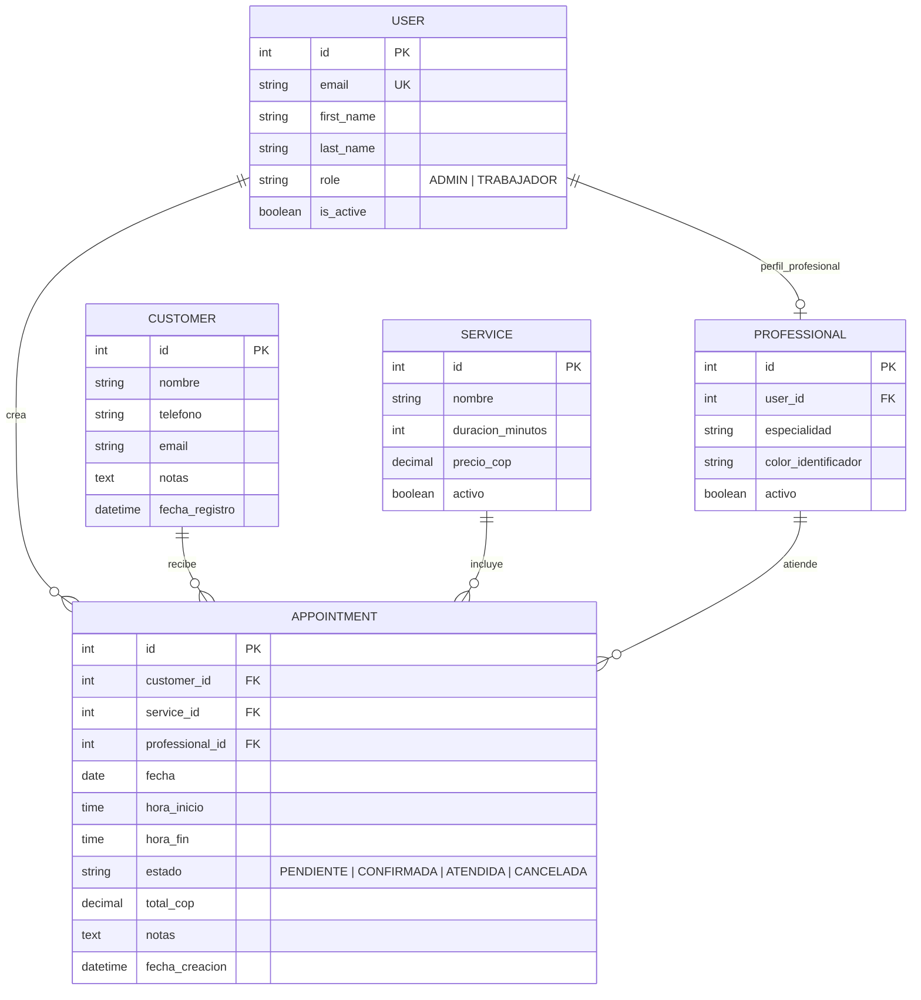
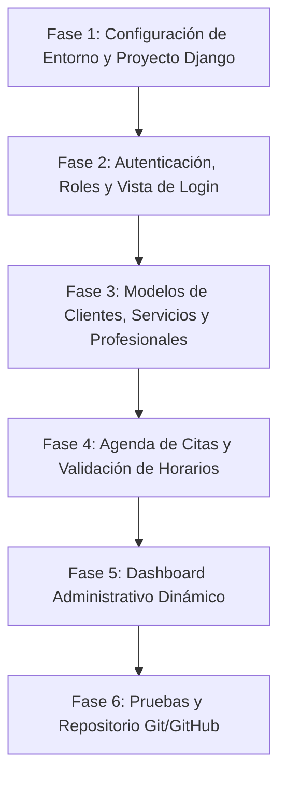

# StudioGest: Guía Técnica y Plan de Implementación Paso a Paso

Sistema web de gestión para barberías y peluquerías desarrollado para la asignatura **Desarrollo de Software y Aplicaciones Web II**.

---

## 1. Diagnóstico de los Diseños y Adaptación de Google Stitch

Los prototipos exportados desde Google Stitch proporcionan la base visual y la identidad de marca definida en `DESIGN.md`. A continuación se detalla cómo adaptar estos prototipos a un sistema web funcional en Django:

### 1.1 Elementos Recibidos y Estado
* **Logotipo oficial (`logo_studiogest`)**: Extraído en formato vectorial SVG (`logo_studiogest.svg`), combinando Azul Noche (`#101827`), Turquesa (`#0D9488`) y Dorado Suave (`#D5A66D`).
* **Vistas de Escritorio y Móvil**:
  1. *Inicio de sesión*: Login transaccional sin barras de navegación globales.
  2. *Dashboard administrativo*: Panel bento con KPIs (ventas, citas, inventario), próximas citas del día y estado de estilistas.
  3. *Agenda semanal con Modal de Cita*: Calendario semanal por horarios y profesionales, más diálogo modal de registro de cita.

### 1.2 Depuraciones y Correcciones Necesarias
1. **Unificación Responsive en Django Templates**: En lugar de mantener archivos HTML separados para móvil y escritorio, crearemos **una sola plantilla por vista** utilizando las utilidades responsive de Tailwind CSS (`hidden lg:flex`, `grid-cols-1 lg:grid-cols-12`, etc.), compartiendo la misma lógica de backend y contexto.
2. **Estandarización de Sede**: Reemplazar referencias ficticias ("Chicó Norte", sedes Bogotá) por una única **"Sede Principal"** fija en esta primera etapa.
3. **Dinamización de Fechas**: Sustituir textos estáticos ("17 de Noviembre de 2025") por la etiqueta de plantilla `` y filtros de fecha en Django.
4. **Tratamiento de Alertas y Errores**: En el prototipo el recuadro rojo de *"Credenciales inválidas"* estaba hardcodeado. En Django, se condiciona con `` para mostrarse únicamente cuando la autenticación falle o el servidor envíe una notificación.
5. **Eliminación de Promesas Falsas**: Quitar textos de mockups como *"Base de datos local sincronizada"* o menciones de respaldos automáticos que no corresponden al alcance actual.

---

## 2. Arquitectura del Proyecto Django

### 2.1 Estructura Modular de Aplicaciones
Separaremos el proyecto en aplicaciones cohesivas:

```text
studiogest/
├── manage.py
├── config/                      # Configuración central del proyecto
│   ├── __init__.py
│   ├── settings.py
│   ├── urls.py
│   └── wsgi.py
├── apps/
│   ├── accounts/                # Autenticación, modelo User personalizado y roles
│   ├── dashboard/               # Indicadores, métricas y resumen operativo
│   ├── customers/               # Gestión de clientes frecuentes y datos de contacto
│   ├── services/                # Catálogo de servicios y perfiles de profesionales
│   └── appointments/            # Agenda, disponibilidad horaria y registro de citas
├── static/
│   ├── css/
│   ├── js/
│   └── img/
│       └── logo_studiogest.svg  # Logotipo vectorial del sistema
├── templates/
│   ├── base.html                # Plantilla maestra (head, tailwind, sidebar, topbar, bottom nav)
│   ├── includes/
│   │   ├── sidebar.html         # Navegación lateral escritorio (260px)
│   │   ├── topbar.html          # Cabecera superior con fecha y búsqueda
│   │   ├── bottom_nav.html      # Barra de navegación inferior móvil
│   │   └── messages.html        # Alertas globales de feedback (éxito, error)
│   ├── accounts/
│   │   └── login.html
│   ├── dashboard/
│   │   └── index.html
│   └── appointments/
│       ├── calendar.html
│       └── components/
│           └── appointment_modal.html
└── requirements.txt
```

---

## 3. Modelo de Datos y Entidades Principales



### 3.1 Regla de Oro: Validación de Disponibilidad (Sin Solapamientos)
Para evitar que un barbero o estilista tenga dos citas al mismo tiempo, el formulario y modelo de citas deben validar:

$$\text{Cita Existente: } [I_{exist}, F_{exist}) \quad \text{vs} \quad \text{Nueva Cita: } [I_{nueva}, F_{nueva})$$

Existe conflicto si:
$$I_{nueva} < F_{exist} \quad \land \quad F_{nueva} > I_{exist}$$

En Django ORM:
```python
conflicto = Appointment.objects.filter(
    professional=profesional,
    fecha=fecha,
    estado__in=['PENDIENTE', 'CONFIRMADA', 'EN_PROCESO'],
    hora_inicio__lt=hora_fin_nueva,
    hora_fin__gt=hora_inicio_nueva,
).exclude(pk=cita_id) # Si se está editando
```

---

## 4. Identidad Visual y Configuración de Tailwind

Según `DESIGN.md`, la paleta y fuentes se integran en Tailwind de la siguiente forma:

* **Azul Noche (Primary)**: `#101827`
* **Turquesa Oscuro (Secondary)**: `#0D9488` (Hover: `#0F766E`)
* **Dorado Suave (Tertiary / VIP)**: `#D5A66D`
* **Superficie / Fondo**: `#F8FAFC` (Slate-50)
* **Bordes / Delimitadores**: `#E2E8F0` (Slate-200)
* **Tipografías**:
  * Títulos y Valores COP: `Plus Jakarta Sans`
  * Cuerpo y Controles: `Inter`
* **Iconografía**: `Material Symbols Outlined`

---

## 5. Plan de Ejecución Paso a Paso



### Fase 1: Configuración del Entorno y Proyecto Django
1. Crear entorno virtual `.venv` para aislar las dependencias:
   ```powershell
   python -m venv .venv
   .venv\Scripts\Activate.ps1
   ```
2. Instalar dependencias esenciales:
   ```powershell
   pip install django psycopg2-binary python-dotenv pillow
   ```
3. Generar `requirements.txt`.
4. Iniciar el proyecto con estructura limpia (`config/`).
5. Configurar `settings.py` con soporte para base de datos PostgreSQL y fallback a SQLite para desarrollo inicial rápido.
6. Guardar el archivo `logo_studiogest.svg` en `static/img/`.

### Fase 2: Autenticación y Vista de Login
1. Crear app `apps.accounts`.
2. Definir `CustomUser` con `role` (`ADMIN` o `TRABAJADOR`).
3. Crear vista de login basada en clase (`LoginView`) o función personalizada que autentique por email o username.
4. Adaptar la plantilla `login.html` usando el código de Stitch, pero:
   * Conectando el formulario con `` y campos reales (`{{ form.username }}`, `{{ form.password }}`).
   * Insertando el logotipo SVG local mediante ``.
   * Mostrando el bloque de alerta de credenciales inválidas **solo si hay error real**.
5. Proteger las rutas privadas con `@login_required` o `LoginRequiredMixin`.

### Fase 3: Catálogo de Servicios, Clientes y Profesionales
1. Crear apps `apps.customers` y `apps.services`.
2. Registrar modelos en el panel de administración de Django (`admin.py`) para poder dar de alta rápidamente:
   * Barberos / estilistas de prueba (ej. Julián Restrepo, Camila Torres).
   * Servicios con precios en COP (ej. "Corte Degradado + Barba Spa - $65.000").
   * Clientes frecuentes de prueba.

### Fase 4: Agenda de Citas y Modal
1. Crear app `apps.appointments`.
2. Adaptar la vista `calendar.html` extendiendo `base.html`.
3. Conectar el botón `+ Nueva Cita` con el modal interactivo:
   * Selects poblados dinámicamente desde la base de datos (`Service.objects.filter(activo=True)`, `Professional.objects.filter(activo=True)`).
   * Formulario POST para guardar la cita.
   * Validación en backend para rechazar cruces de horarios.
4. Mostrar las citas creadas en la grilla horaria o lista semanal.

### Fase 5: Dashboard Administrativo
1. Crear app `apps.dashboard`.
2. En la vista del dashboard, calcular los indicadores reales:
   * Citas del día: `Appointment.objects.filter(fecha=hoy).count()`
   * Ventas proyectadas del día: suma de `total_cop` de las citas atendidas/confirmadas.
   * Próximas citas: lista ordenada de citas de la jornada.
3. Renderizar `index.html` extendiendo `base.html` con datos dinámicos.

### Fase 6: Repositorio Git y GitHub
1. Inicializar repositorio Git local (`git init`).
2. Configurar `.gitignore` para excluir `.venv/`, `__pycache__/`, `db.sqlite3`, `.env`.
3. Crear commit inicial estructurado.
4. Conectar con el repositorio remoto de GitHub del equipo.
